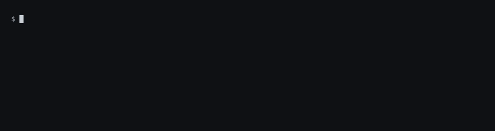
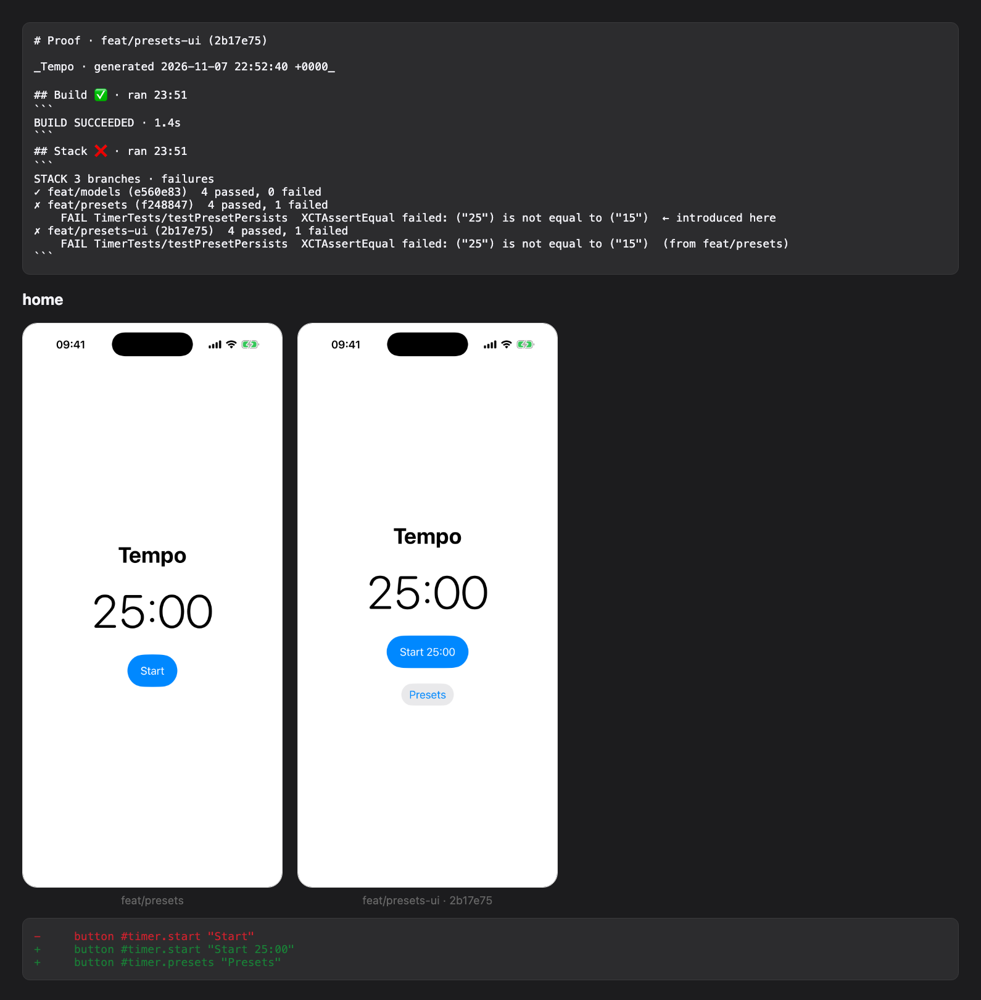

# proof

**Evidence that an iOS change actually works, for coding agents and the people reviewing their work.**

**Documentation: https://carloshmartins.github.io/proof**

[](LICENSE)


AI coding agents (Claude Code, Codex, Cursor…) can change an iOS app in minutes. They are much worse at
knowing whether the change works. They drown in thousands of lines of `xcodebuild` output, they can't see
the simulator, and they often say "done" when the screen is broken.

`proof` is a command-line tool that closes that gap. It gives an agent, or you, five things:

| | What you get | Command |
|---|---|---|
| 1 | **Build and test results you can read.** Errors with `file:line`, failing tests with the assertion. Nothing else. | `proof build`, `proof test` |
| 2 | **Eyes and hands on the simulator.** See what's on screen as text, then tap, type and swipe by accessibility identifier. | `proof ui …` |
| 3 | **Before and after.** A screenshot of a screen, plus a list of what changed on it compared with the branch your PR targets. | `proof snap <screen> --compare base` |
| 4 | **Every PR in a stack tested on its own.** Find the exact PR that broke a test or a screen. | `proof test --stack` |
| 5 | **One report for the reviewer.** Build, tests and screenshots side by side in an HTML page. | `proof packet --open` |

You don't change your app. No test target, no SDK, no code. proof works from the outside, and everything it
writes goes to `~/.proof`, never into your repository.



<sub>A stack of three PRs in the [Tempo demo app](Examples/Tempo). The middle PR breaks a test, and proof says
so. Real output; the wait while it builds and tests is sped up 8×.</sub>

## Quick start

```sh
brew install carloshmartins/tap/proof    # 1. install
proof setup                              # 2. teach your agent to use it (installs the skill)
cd path/to/YourApp                       # 3. once per app
proof init --scheme YourApp --simulator "iPhone 16"
proof build                              # 4. try it
```

Then ask your coding agent for a change. It builds, tests and checks the screen with proof, and ends with a
report you can open with `proof packet --open`.

> **Status: early (0.x).** Commands, the flow format and the `~/.proof` layout can still change between
> minor versions. Feedback and issues are very welcome.

---

## Contents

- [Quick start](#quick-start)
- [See it in 60 seconds](#see-it-in-60-seconds)
- [Install](#install)
- [Set up your app](#set-up-your-app)
- [Use it with a coding agent](#use-it-with-a-coding-agent)
- [What each part does](#what-each-part-does)
- [Branches: main, develop, release branches and stacks](#branches-main-develop-release-branches-and-stacks)
- [Stacked pull requests](#stacked-pull-requests)
- [Flows: replayable UI journeys](#flows-replayable-ui-journeys)
- [All commands](#all-commands)
- [How it works](#how-it-works)
- [Privacy](#privacy)
- [Troubleshooting](#troubleshooting)
- [Contributing](#contributing)
- [Roadmap](ROADMAP.md)

---

## See it in 60 seconds

**Build.** Instead of 3,000 lines of compiler log:

```
$ proof build
BUILD FAILED · 2 errors · 14 warnings · 38.2s
error  Modules/Login/Sources/LoginView.swift:42:17  cannot find 'viewModel' in scope
error  Modules/Settings/Sources/SettingsStore.swift:88:5  missing return in instance method expected to return 'Bool'
```

While it builds, one line says what xcodebuild is doing, so a long build never looks stuck:


**Look at the screen, prove the change, act on it.** The accessibility tree as text an agent can read; a
snap compared with the branch this PR targets; then a tap and a check, by identifier, never by guessing
coordinates:


**Hand over a report.** `proof packet --open` opens one page with the build, the stack and every screen
before and after, with what changed:



---

## Install

You need a Mac with **macOS 14+**, **Xcode 16+** and at least one **iOS Simulator** runtime. For stacks
and PR comments you also need the [GitHub CLI](https://cli.github.com) (`gh`), signed in.

### With Homebrew (recommended)

```sh
brew install carloshmartins/tap/proof
proof setup
```

- `brew install` builds proof from source with your Xcode (about a minute) and puts `proof` on your `PATH`.
- `proof setup` installs the **agent skill** in `~/.claude/skills/proof`, so agents know how to use proof.
  Another agent? `proof setup --skill-dir <its skills folder>/proof`.
- The simulator runner builds itself the first time you use `proof ui` (about a minute, once).

Update with `brew upgrade proof`.

### From source

```sh
git clone https://github.com/carloshmartins/proof && cd proof
make install
```

This puts `proof` in `~/.local/bin` (make sure it's on your `PATH`) and installs the skill in
`~/.agents/skills/proof` (`make install SKILL_DIR=<folder>/proof` for another folder).

Check either way: `proof --version`.

## Set up your app

Once per repository, from its folder:

```sh
proof init --scheme MyApp --simulator "iPhone 16"
proof doctor
```

- `--scheme` is the Xcode scheme to build and test.
- `--simulator` is the simulator to run on (a name or a UDID).
- Optional: `--test-plan Unit`, `--bundle-id com.example.app`, `--prepare "tuist generate"` (a command to
  run in a fresh checkout before building), `--trunk develop` (see
  [Branches](#branches-main-develop-release-branches-and-stacks)).

`proof init --show` prints the settings. `proof doctor` checks Xcode, the simulator, the runner and `gh`,
and tells you what's missing. Settings live in `~/.proof/config.json`, not in your repo.

proof works with a `.xcworkspace`, a `.xcodeproj` (Tuist included) or a Swift package at the repository
root.

## Use it with a coding agent

`proof setup` installs the skill where Claude Code reads it (`~/.claude/skills/proof`). For another agent,
point it at that agent's skills folder:

```sh
proof setup --skill-dir ~/.agents/skills/proof
```

The skill tells the agent to:

- use `proof build` and `proof test` instead of raw `xcodebuild`,
- look at the screen with `proof ui tree` before tapping,
- prove UI changes with `proof snap <screen> --compare base`,
- finish with `proof packet` and give you the report's path.

Then ask for a change as usual. Before merging, read the report instead of guessing from the diff:

```sh
proof packet --open
```

---

## What each part does

### Build and test: `proof build`, `proof test`

They run `xcodebuild` for you and print only what matters: the result, each error with `file:line`, and
each failing test with its assertion message. Paths are relative to your repo, and duplicates are removed.

```sh
proof build                  # errors only
proof build --warnings       # also list warnings
proof test                   # the configured test plan
proof test --only AppTests/LoginTests/testInvalidPassword
xcodebuild … 2>&1 | proof brief    # condense output you already have
```

### The simulator: `proof run`, `proof ui`

`proof run` builds, installs and launches your app on the simulator. `proof ui` then drives it through the
**accessibility tree**: the same structure VoiceOver uses, where every element has a type, an optional
identifier (`#login.submit`) and a label (`"Log in"`).

```sh
proof ui tree                 # everything on screen
proof ui tree -i              # interactive elements only
proof ui tap --id login.submit          # also --label "Log in", --text "log"
proof ui type "hello" --id search.field --clear
proof ui swipe up
proof ui wait --id home.title --timeout 15
proof ui expect --id home.title         # an assertion: exit 1 if it's not there
proof ui alert                          # accept a system alert (--dismiss, --button "Allow")
proof ui open tempo://presets/new       # a deep link; also push, permission, location
```

Elements without an identifier are hard to target reliably. `proof ax scan` lists the controls in your
code that have none, and `proof ui tree --missing-ids` does the same for the current screen.

### Before and after: `proof snap`

`proof snap <name>` saves a screenshot and the accessibility tree of the current screen. With `--compare`,
it also lists what changed compared with the snap of the same name on another branch:

```sh
proof snap login                      # just this branch
proof snap login --compare base       # vs the branch this PR targets
proof snap login --compare develop    # vs any branch you name
```

Lines starting with `-` disappeared and lines starting with `+` are new. The diff shows the change as text
for the agent; the packet shows the screenshots side by side for you.

The other branch needs a snap with the same name. A flow does it for you: `proof flow run <flow> --compare
base` replays the flow on the base branch first when it has no snaps yet (in a worktree, your checkout is
untouched), then diffs every screen. `proof flow run <flow> --stack` does the same for every branch of a
stack.

### The report: `proof packet`

`proof packet` collects everything this branch produced (build, tests, stack results, accessibility
findings, screenshots and their diffs) into `report.md` and `report.html` under `~/.proof`. `--open` opens
the HTML page. Nothing is uploaded anywhere.

### PR review comments: `proof pr comments`

Lists the unresolved review threads on this branch's PR, with `path:line`, so an agent can address them.

---

## Branches: main, develop, release branches and stacks

proof never assumes your main branch is called `main`. Two words matter:

- **Trunk**: the branch your work starts from. By default it's the repository's **default branch on
  GitHub** (what `origin/HEAD` points to: `main`, `master`, `develop`…). If git doesn't know it, proof
  looks for a local `main`, `master` or `develop`. To set it yourself:

  ```sh
  proof init --trunk develop
  ```

- **Base**: the branch a pull request **targets**. Usually the trunk, but not always: a fix for
  `release/2.0`, or a PR in the middle of a stack, targets another branch.

`--compare base` uses the base. It asks GitHub which branch this branch's PR targets and compares with that
one. Without an open PR, it uses the trunk.

| Your branch | Its PR targets | `--compare base` compares with |
|---|---|---|
| `feat/login` | `main` | `main` |
| `feat/login` | `develop` | `develop` |
| `fix/crash` | `release/2.0` | `release/2.0` |
| `feat/presets-ui` (2nd PR in a stack) | `feat/presets` | `feat/presets` |
| `spike/idea` | no PR | the trunk |

You can always name a branch directly: `--compare release/2.0`.

## Stacked pull requests

A **stack** is a chain of small PRs where each one builds on the one below:

```
develop
 └─ feat/models              PR #1 → develop
     └─ feat/presets         PR #2 → feat/models
         └─ feat/presets-ui  PR #3 → feat/presets
```

Small PRs are easier to review, but a bug in PR #1 shows up as failures in #2 and #3 too. proof finds the
stack from your open PRs (it works with [`gh stack`](https://github.com/github/gh-stack), Graphite, spr or
stacks made by hand) and tests each branch on its own:

```
$ proof test --stack
STACK 3 branches · failures
✓ feat/models (a1b2c3d)  182 passed, 0 failed
✗ feat/presets (8a6c41e)  182 passed, 1 failed
    FAIL TimerTests/testPresetPersists  XCTAssertEqual failed: ("25") is not equal to ("15")  ← introduced here
✗ feat/presets-ui (d64d913)  182 passed, 1 failed
    FAIL TimerTests/testPresetPersists  (from feat/presets)
```

`← introduced here` marks the PR that broke the test, so you fix it there, not at the top.

```sh
proof test --stack                    # the stack the current branch belongs to
proof test --stack --stop-on-fail
proof test --stack --branches a,b,c   # an explicit list, bottom to top
proof flow run login --stack          # replay a UI flow on every branch, comparing each with the one below
```

Each branch is checked out in a separate worktree under `~/.proof/worktrees`, so your own checkout is
never touched. A stack can start from any branch: `main`, `develop` or a release branch.

## Flows: replayable UI journeys

A flow is a plain text file of `proof ui` steps, without the `proof ui` prefix. It turns "I checked the
login screen by hand" into something an agent can rerun on every branch.

```
launch --arg -resetState
tap --id onboarding.skip
type ${EMAIL} --id login.email
tap --id login.submit
expect --id home.title --timeout 15
snap home
```

Flows also support `sleep <seconds>`, `include <other-flow>`, and `${NAME}` variables from
`--var NAME=value` or the environment. Keep passwords out of the file: use `${PASSWORD}`.

```sh
proof record start                   # then run proof ui commands…
proof record stop login              # …and save them as the flow "login"
proof flow list
proof flow run login --var EMAIL=a@b.c
proof flow run login --compare base --video
proof flow run login --stack
```

A failing step stops the flow and snaps the screen as `<flow>-failed`, so you see what was actually there.
Flows live in `~/.proof/flows/<repo>/`.

---

## All commands

Every command prints short text by default, accepts `--json` for scripts, and exits non-zero on failure.

| Command | What it does |
|---|---|
| `proof init` | Save this repo's settings (scheme, simulator, trunk…) |
| `proof doctor` | Check Xcode, simulators, the runner and `gh` |
| `proof setup` | Reinstall the runner sources and the agent skill |
| `proof build` | Build and print a condensed result |
| `proof test` | Test this branch (`--stack` for every branch of the stack) |
| `proof brief` | Condense `xcodebuild` output from stdin |
| `proof run` | Build, install and launch on the simulator |
| `proof ui tree / tap / type / swipe / wait / expect / alert / at / launch / home` | Drive the simulator |
| `proof ui open / push / permission / location` | Deep links, notifications, permissions, location |
| `proof ui crashes` | The app's latest crash, with file:line (failing steps report crashes on their own) |
| `proof snap <name>` | Screenshot + accessibility tree (`--compare base` or a branch name) |
| `proof record start / stop <name>` | Record `proof ui` steps into a flow |
| `proof flow list / show / check / run` | Manage and replay flows |
| `proof video start / stop` | Record the simulator screen |
| `proof ax scan` | Find controls without accessibility identifiers in your code |
| `proof ax audit` | Xcode's accessibility audit of the current screen: contrast, hit areas, Dynamic Type, … |
| `proof pr comments` | Unresolved review threads on this branch's PR |
| `proof packet` | Build the HTML/Markdown report (`--open` to view it) |
| `proof stop` | Stop the newest running proof command, like Ctrl-C (`--all` for every one) |

`proof <command> --help` shows every option.

## How it works

```
   you / an agent
       │ proof build, test, flow run …
       ▼
   ┌────────┐   writes    ┌──────────┐
   │ proof  │───────────▶ │ ~/.proof │
   └────────┘             └──────────┘
       │ JSON commands on 127.0.0.1:22087
       ▼
   ProofRunner (XCUITest) ──▶ iOS Simulator ──▶ your app
```

- **Runner.** A small, generic XCUITest bundle attaches to any installed app by bundle identifier and takes
  commands on `127.0.0.1:22087`. That's how proof taps and reads the screen without a UI test target in your
  app. It's built on first use and rebuilt only when its sources change.
- **Events.** Every build, test, step, snap and flow appends a JSON line to
  `~/.proof/sessions/<repo>/<branch>/events.jsonl`. Long commands also register in `~/.proof/active/`,
  which is how `proof stop` finds them. Other tools can read these files to show runs live.
- **Stacks.** Each branch is checked out in one reusable worktree (`~/.proof/worktrees/<repo>`) with its own
  DerivedData, so builds stay incremental and your checkout is never touched.

What's in `~/.proof`:

```
~/.proof/
  config.json                    settings per repo
  sessions/<repo>/<branch>/      events, results, snaps, logs, videos, report
  flows/<repo>/                  your .flow files
  active/                        runs in progress
  runner/                        runner sources, build and log
  worktrees/<repo>/              the worktree used for stack runs
```

Delete the folder to reset everything.

## Privacy

- No accounts, analytics or telemetry.
- The only network access is what you ask for: `gh` talks to GitHub for stacks, PR bases and PR comments.
  The runner listens on localhost only.
- Nothing is written to your repository. Screenshots, videos and logs stay in `~/.proof`.

## Troubleshooting

| Problem | Try |
|---|---|
| `proof: command not found` | Homebrew: `brew install carloshmartins/tap/proof`. From source: check `~/.local/bin` is on your `PATH`. |
| The agent doesn't use proof | Run `proof setup` (or `proof setup --skill-dir <your agent's skills folder>/proof`) and start a new agent session. |
| "not inside a git repository" | Run proof from inside your app's git repository. |
| "no scheme is configured" | `proof init --scheme <Scheme> --simulator "<Device>"` |
| "no stack found" | The branch needs an open PR (`gh pr create`), or pass `--branches a,b,c`. |
| `--compare base` picks the wrong branch | Check the PR's base on GitHub, or set the trunk: `proof init --trunk <branch>`. |
| "no 'login' snap on develop to compare with" | Put the screen in a flow and run `proof flow run <flow> --compare develop`: proof snaps develop for you. |
| "element not found" | Run `proof ui tree` and pick a selector that's actually on screen. |
| The runner doesn't start | Read `~/.proof/runner/runner.log`. If the port is taken: `PROOF_PORT=22100 proof ui start`. |
| Anything else | Run `proof doctor` and [open an issue](https://github.com/carloshmartins/proof/issues/new/choose) with its output. |

## Contributing

```sh
swift build && swift test     # also runs on Linux
make install
```

```
Sources/proof        command-line parsing (ArgumentParser)
Sources/ProofKit     everything proof does: build/test parser, stacks, runner client, flows, snaps, packet
Runner/              the XCUITest runner, installed to ~/.proof/runner/src
skill/proof/         the agent skill installed by make install
```

Changes go through pull requests, and stacked PRs are welcome: proof tests every branch of them. See
[CONTRIBUTING.md](CONTRIBUTING.md). What's planned next is in [ROADMAP.md](ROADMAP.md).

## License

[Apache License 2.0](LICENSE).
